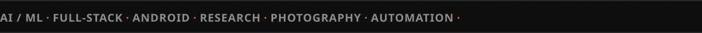

[`mosambiswas.com`](https://www.mosambiswas.com/) · [`résumé`](https://www.mosambiswas.com/resume.html) · [`sheichobi · photography`](https://www.mosambiswas.com/sheichobi/sheichobi.html) · [`linkedin`](https://linkedin.com/in/mosambiswas) · [`g.dev`](https://g.dev/MosamBiswas) · [`mail`](mailto:mosambiswas999@gmail.com)

In a terminal? `ssh mosambiswas.com` · `curl mosambiswas.com`

B.Tech AI & Data Science graduate, RAIT, D.Y. Patil University, Class of 2026. I care about the whole loop, from a model's confusion matrix to the button a person actually presses.

### `(01) · SELECTED WORK`

| `PROJECT` | `WHAT IT IS` | `BUILT WITH` |
| :-- | :-- | :-- |
| [**AMINAL**](https://github.com/BiswasMosam/Aminal-Public) | Local-first voice assistant for Windows. Voice, vision and memory on your own GPU, nothing leaves the machine | `Python` `Whisper` `Ollama` |
| [**Locals**](https://github.com/BiswasMosam/Locals) | A town of AI users that test your web and Android apps like real people and say where they got stuck. 114 locals from 9 job families, human limits enforced in code | `Python` `Playwright` `Ollama` |
| [**Fill.ai**](https://github.com/BiswasMosam/Fill.ai) | AI form filler for Chrome. Learns you from your resume, fills what it knows, asks about the rest, never submits. 121 end-to-end checks run on every push | `JavaScript` `Chrome MV3` `LLMs` |
| [**MindFirst**](https://github.com/BiswasMosam/Mind-First) | Mental-health screening. A GAD-7 style pre-screen decides who takes one of 7 condition tests, then offers self-help and a doctor booking | `Next.js` `Flask` `Prisma` |
| [**PixelForge**](https://github.com/BiswasMosam/PixelForge) | Leukemia detection on C-NMC at 0.89 ROC-AUC, a custom GAN augments scarce medical data | `PyTorch` `GANs` |
| [**Rail Mitra**](https://github.com/BiswasMosam/RailMind) | Railway platform and track assignment, solved as constraint programming | `Python` `OR-Tools` |
| [**IntelliStatement**](https://github.com/BiswasMosam/LLM-bank-statement-analyzer) | Bank statements in, financial insight out. LLM extraction from PDFs and images | `FastAPI` `Streamlit` `LLM` |
| [**Committee Connect**](https://github.com/BiswasMosam/CommitteesManagement) | Task and attendance tracking for college committees, real-time sync. A four-person team project | `Android` `Java` `Firebase` |
| [**Sim Sim**](https://github.com/BiswasMosam/SimSim-Virtual-Assistant) | Voice-driven desktop assistant with a native GUI and 23 commands, from alarms to WhatsApp | `Python` `PySide6` |

Running in a browser right now: [**Locals**](https://www.mosambiswas.com/Locals/), the town's window on real kept days, [**PixelShift**](https://www.mosambiswas.com/PixelShift/), batch image conversion with zero uploads, and [**To-Do**](https://www.mosambiswas.com/To-Do/), full-stack task boards with auth. The rest, including [the site itself](https://github.com/BiswasMosam/BiswasMosam.github.io), lives at [`mosambiswas.com`](https://www.mosambiswas.com/).

### `(02) · EXPERIENCE`

| `WHERE` | `WHAT` | `WHEN` |
| :-- | :-- | :-- |
| **Sedna Technologies** | Software Developer Intern. Work across 4 client projects, plus a full client-facing dashboard built solo | `Jan / Apr 2026` |
| **Photocircle RAIT** | Technical Head. 3 workshops (75+ students), participation up 60% | `2024 / 2025` |

Certified in AI by **Samsung Innovation Campus**, a four-month course co-certified by Samsung Southwest Asia & TSSC, Nov 2025 / Mar 2026. [All eleven certificates](https://www.mosambiswas.com/certificates.html).

### `(03) · RESEARCH`

[**Comparative Analysis of Psychometric Data for Assessing Mental Health Testing Needs Using Machine Learning Models**](https://doi.ieeecomputersociety.org/10.1109/ICAIIHI67124.2025.11403838) · IEEE Xplore · ICAIIHI 2025 · [`pdf`](https://www.mosambiswas.com/ResearchPaper.pdf)

Can supervised learning decide who should proceed to a full mental-health evaluation? Five models benchmarked on PHQ-9 / GAD-7 responses with cross-validation and SHAP interpretability. Logistic regression came out near-perfect and transparent enough to be clinically meaningful. In a clinic, explainable beats clever.

### `(04) · STACK`

**ML & Data** `Python` `PyTorch` `scikit-learn` `XGBoost` `SHAP` `Pandas` `LLMs (Ollama, Claude, Gemini)`

**Web & Mobile** `JavaScript` `TypeScript` `Next.js` `Node.js` `Flask` `FastAPI` `Chrome Extensions` `Flutter` `Android (Java)`

**Tools** `Git` `GitHub Actions` `MySQL` `SQLite` `Streamlit` `Figma` `Photoshop`

Currently deep in: `LLMs` · `computer vision` · `system design`

### `(05) · OFF SCREEN`

Street, portraits, monochrome, concerts, wildlife. Technical Head, Photocircle RAIT, 2024 / 2025.
The archive is [**SheiChobi**](https://www.mosambiswas.com/sheichobi/sheichobi.html), Bengali for *“that picture.”* 84 photographs, six collections.

 

`© 2026 MOSAM BISWAS · NAVI MUMBAI, IN · ALL RIGHTS RESERVED` · `NO TEMPLATES, NO WIDGETS · BUILT BY HAND`

